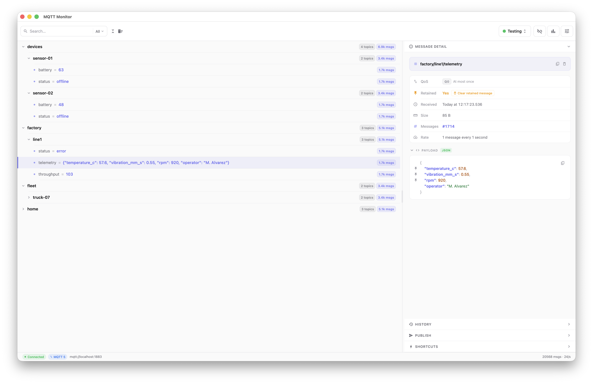
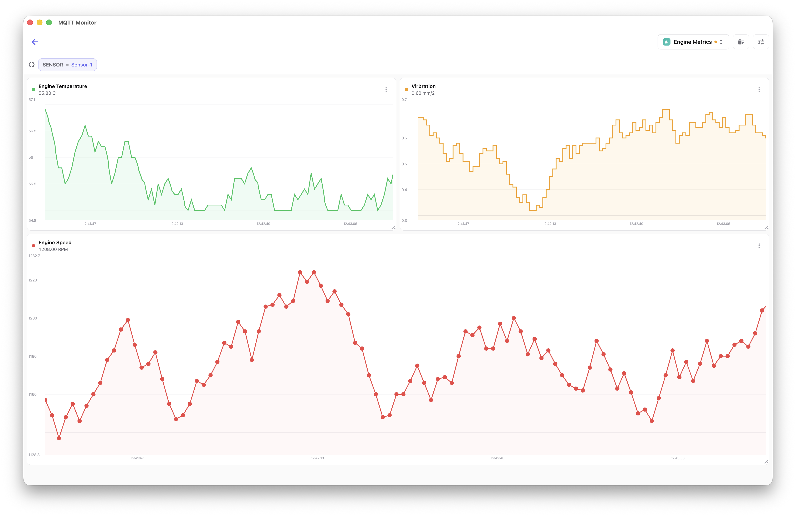
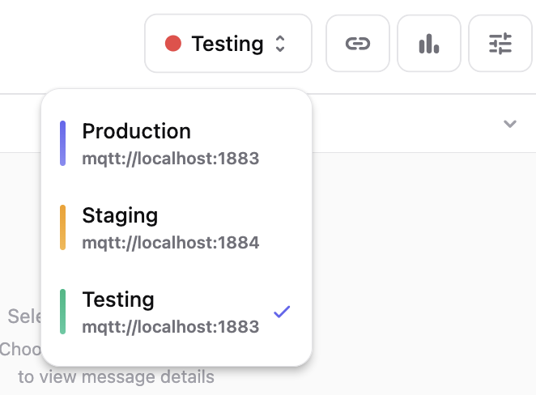
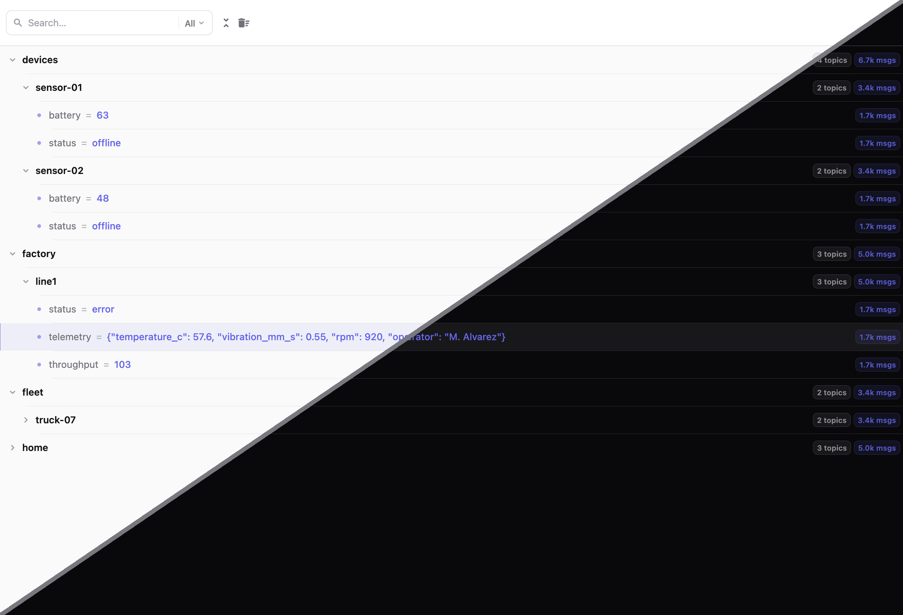
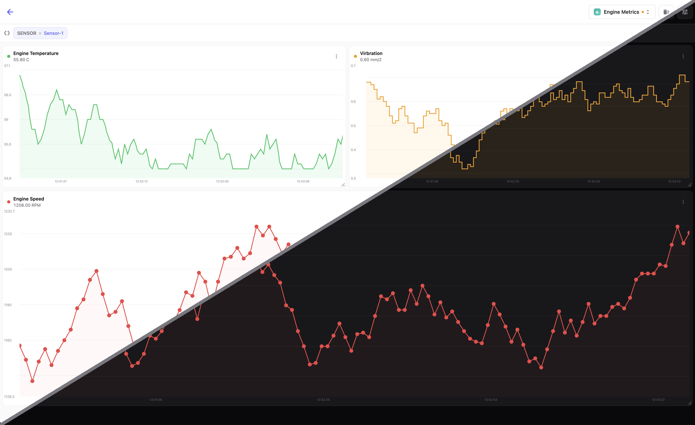
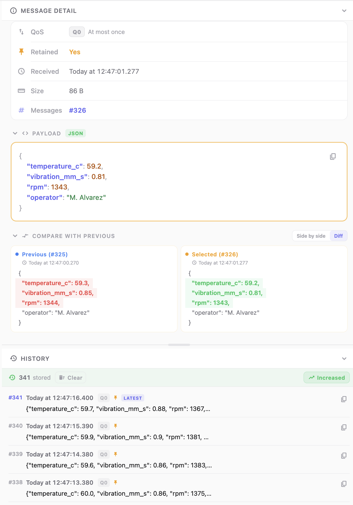
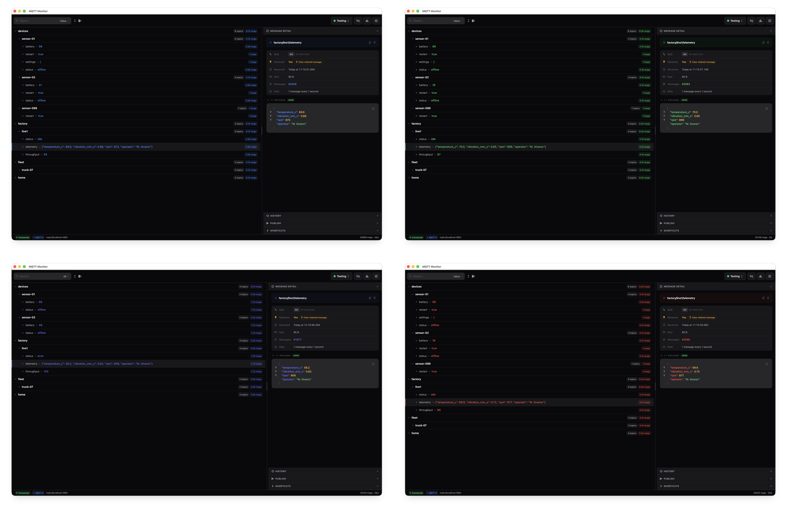

<h1 align="center">MQTT Monitor</h1>

<p align="center">
  A fast, native desktop MQTT client for seeing what's actually happening on your broker.
</p>


<p align="center">
  <a href="https://github.com/mijelsma/MQTT-Monitor/releases/latest">
    <strong>⬇️ Download MQTT Monitor</strong>
  </a>
</p>

<p align="center">
  <a href="https://github.com/mijelsma/MQTT-Monitor/releases/latest">
    
  </a>
  <a href="LICENSE">
    
  </a>

</p>

<p align="center">
  <a href="https://ko-fi.com/micheljelsma">
    
  </a>
  <br>
  <sub>If MQTT Monitor saves you time, consider supporting its development ☕</sub>
</p>

<p align="center">
  
</p>

---

## Download

MQTT-Monitor ships in prebuild binaries for windows macos and linux. 

Download the latest build for your platform from GitHub Releases:

<p align="center">
  <a href="https://github.com/mijelsma/MQTT-Monitor/releases/latest">
    <strong>View the latest release →</strong>
  </a>
</p>

Choose the appropriate installer or package for your operating system from the **Assets** section.

---

## Why MQTT Monitor?

Watching a fleet of devices, a home automation setup, or a busy production broker deserves something better than a log window.

There are plenty of MQTT tools out there, but I wanted one built around how I actually work: something that makes it easy to **see what's happening** instead of decoding an endless stream of topics and JSON manually.

MQTT Monitor is built around the workflows I kept running into myself, and I use it every day.

It gives you:

* A **live topic tree** that reacts as messages arrive
* Support for **MQTT 3.1.1 and MQTT 5**
* Multiple saved broker profiles
* **TLS certificate** support
* Search across topics and payloads
* Adjustable per-topic **message history**
* Side-by-side payload diffs
* Live charts for numeric MQTT values
* Reusable publish shortcuts with variables
* Light and dark themes with customizable accent colors
* Auto-connect for brokers you use every day

<p align="center">
  
</p>

---

## Contents

* [Download](#download)
* [Why MQTT Monitor?](#why-mqtt-monitor)
* [Features](#features)
* [Privacy](#privacy)
* [Building from source](#building-from-source)
* [Desktop Updates](docs/updates.md)
* [Reporting Issues](#reporting-issues)
* [Support the Project](#support-the-project)
* [License](#license)

---

## Features

### Broker connections, done properly

Switch between brokers in a couple of clicks and keep separate profiles for your local development broker, staging environment, production systems, or home automation setup without entering credentials every time.

Both **MQTT 3.1.1 and MQTT 5** are supported, including MQTT 5 properties such as reason codes, so you're not stuck guessing why messages aren't arriving.

<p align="center">
  
</p>

For brokers using TLS, certificate handling is built in rather than bolted on.

Configure your:

* Root CA
* Client certificate
* Private key

directly in the connection profile.

No fiddling with external tooling just to get a secure broker connection working.

---

### A topic tree that shows you what's actually happening

The topic tree isn't just a static list.

Topics **flash on activity** as messages arrive, making noisy sensors, changing values, and active parts of your MQTT hierarchy immediately visible.

Instead of watching a wall of messages scroll by, you can get a feel for what's happening across the broker at a glance.

<p align="center">
  
</p>

Need to find something specific?

The search field filters as you type and can search:

* Topic names
* Payload values
* Both at the same time

Useful when you know a device sent a particular value but can't remember which topic it lives under.

---

### Turn MQTT values into a dashboard

Pin numeric topics to the **dashboard** and watch them plot live instead of staring at individual values scrolling past.

Great for:

* Temperatures
* Battery levels
* Power usage
* Sensor readings
* Counters
* Any value where the trend matters more than a single reading

<p align="center">
  
</p>

---

### Message shortcuts, with variables

Save frequently used publish messages as **shortcuts** instead of rebuilding or hand-editing the same payload every time.

Shortcuts can contain dynamic variables such as:

* Timestamps
* Incrementing counters
* Custom placeholders

The same variable system can also be used from dashboard controls, making repetitive testing and device control much faster.

---

### History that works the way you need it to

Every topic keeps a rolling history of previous messages.

You control the **number of retained data points**, so chatty topics can stay lightweight while important topics keep a deeper history.

If you're actively debugging a topic, enable **increased monitoring** to retain more history for that topic without increasing memory usage across the entire broker.

When something changes unexpectedly, select two historical messages and **diff them side by side** to see exactly what changed.

<p align="center">
  
</p>

---

### Make it feel like yours

MQTT Monitor can follow your operating system's **light or dark theme** automatically, or you can select one manually.

You can also customize:

* Accent color
* Startup behavior
* Default connection behavior
* Automatic broker connection

So your usual broker can already be connected and streaming by the time the app opens.

<p align="center">
  
</p>

---

## Privacy

MQTT Monitor **doesn't collect or transmit user analytics**.

There is no usage tracking and no automatic crash reporting.

Your broker details and MQTT traffic are not sent to me.

The downside is that if something breaks, I won't automatically know about it, so bug reports are especially useful.

---

## Building from source

The downloads above are for people who simply want to use MQTT Monitor.

If you want to contribute, modify the app, or run a development build, you can build it from source.

### Prerequisites

* [Visual Studio Code](https://code.visualstudio.com/)
* [Flutter](https://docs.flutter.dev/install)
* This repository cloned locally

Clone the repository:

```bash
git clone https://github.com/mijelsma/MQTT-Monitor.git
cd MQTT-Monitor
```

Check your Flutter installation:

```bash
flutter doctor -v
```

Install dependencies:

```bash
flutter pub get
```

### Run in debug mode

```bash
# macOS
flutter run -d macos

# Windows
flutter run -d windows

# Linux
flutter run -d linux
```

The repository also includes VS Code tasks for each desktop platform.

Open the Command Palette (`Cmd+Shift+P` / `Ctrl+Shift+P`), choose **Tasks: Run Build Task**, and select:

| Platform | Task                    |
| -------- | ----------------------- |
| macOS    | `Run — macOS (debug)`   |
| Windows  | `Run — Windows (debug)` |
| Linux    | `Run — Linux (debug)`   |

### Flutter run commands

While the app is running with `flutter run`, the terminal stays interactive and accepts single-key commands without needing to press Enter.

Some useful ones:

* `r` — Hot reload
* `R` — Hot restart
* `v` — Open Flutter DevTools
* `i` — Toggle widget inspector
* `p` — Toggle construction lines
* `P` — Toggle performance overlay
* `c` — Clear the terminal
* `q` — Quit the application
* `h` — Show all available commands

---

### Why Flutter?

MQTT Monitor is built with Flutter and runs as a native desktop application on macOS, Windows, and Linux from one codebase.

Flutter compiles the application rather than shipping it inside a bundled browser, while allowing the desktop versions to share most of their implementation.

That makes it easier to keep the Windows, macOS, and Linux versions in sync and also leaves the door open for mobile versions in the future.

---

## Reporting Issues

MQTT Monitor proudly doesn't track user activity or include automatic crash reporting.

That means if something goes wrong, I won't know unless you tell me.

Found a bug or something behaving strangely?

[Open an issue](../../issues) and, if possible, include:

* What you expected to happen
* What actually happened
* Steps to reproduce the problem
* Any error messages shown
* Your operating system
* Your MQTT Monitor version
* A screenshot or screen recording for UI issues

Clear reproduction steps make bugs much easier to track down and fix.

For UI bugs especially, a screenshot or short screen recording is usually much faster to diagnose than a written description alone.

---

## Support the Project

MQTT Monitor is open source and maintained in my spare time.

If it saves you time and you'd like to support continued development, you can buy me a coffee on Ko-fi.

<p align="center">
  <a href="https://ko-fi.com/micheljelsma">
    
  </a>
</p>

If you find MQTT Monitor useful, **starring the repository also helps other MQTT users discover it.**

---

## License

MQTT Monitor is licensed under the [GNU Affero General Public License v3.0](LICENSE) (`AGPL-3.0-only`).

If you distribute a modified version, or make one available for users to interact with over a network, you must make the corresponding source code available under the same license.
